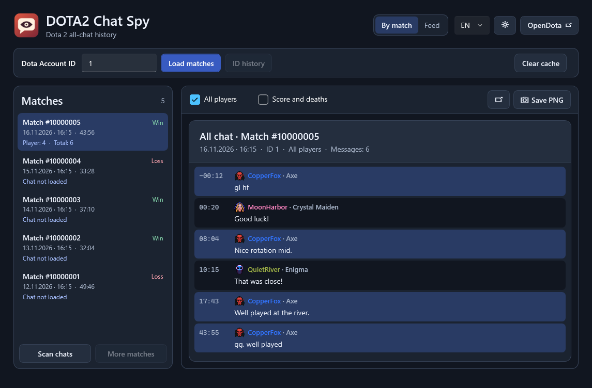

# DOTA2 Chat Spy

DOTA2 Chat Spy is a Windows desktop app for browsing and exporting public Dota 2 all-chat from OpenDota. It opens in English with a dark theme and an empty account field. Use the **EN / RU** dropdown to change the interface language and the sun button to switch themes.



## Install

Download `DOTA2-Chat-Spy-Setup-x64.exe` from [GitHub Releases](https://github.com/Tor-del/DOTA2-ChatSpy/releases), or open a successful run under [Actions](https://github.com/Tor-del/DOTA2-ChatSpy/actions/workflows/windows-release.yml) to download the installer artifact. The installer includes the .NET Desktop Runtime and adds a Start menu shortcut for the current user.

## Use the app

1. Enter a numeric **Dota Account ID** and select **Load matches**. The app loads 25 matches at a time. Use **More matches** to load the next page and **ID history** to reopen a previously entered ID.
2. In **By match** mode, select a match to see its chat. **Scan chats** loads the chats for the listed matches and shows how many messages each contains from the selected player.
3. In **Feed** mode, chats appear newest first as they load. Scroll down or use **More matches** to continue. The feed skips matches without messages under the current filter.
4. Select **All players** to see the full all-chat. The selected player's messages are highlighted. A negative timestamp marks a message sent before the match clock started.
5. Select **Score and deaths** to show the author's kills, deaths, and assists at each message, death summaries between messages, and a final KDA table. `—` marks unknown values and `≥` marks a confirmed minimum. The table is sorted by `(K + A) / D` and shows `∞` for players with contributions and zero deaths.
6. Select **Save PNG** to export a match or **Save feed as PNG** to export all loaded chats with the current filters. Long feeds are split into numbered PNGs.

## OpenDota data

Chat availability depends on public match history and replay parsing. The app shows text all-chat. OpenDota coverage for team chat, voice chat, and chat-wheel events is outside the app's scope. [OpenDota API documentation](https://docs.opendota.com/)

No API key is needed. Requests are spaced at least 1.5 seconds apart. When OpenDota returns HTTP 429, the app stops loading and waits for the server's retry interval before making another request. It waits one minute when the response has no retry interval.

The cache is stored in `%LOCALAPPDATA%\Dota2ChatExtractor\matches`. Entries expire after 30 days for available chats, 10 minutes for unavailable chats, and 5 minutes for match history pages. **Clear cache** removes cached responses. Open chats stay in the window and **ID history** is stored separately in `accounts.json`.

Hero icons are bundled from the Steam CDN. Hero names and player-slot colors come from [OpenDota constants](https://github.com/odota/dotaconstants).

## Build from source

Install the Windows .NET 10 SDK. To run the app locally:

```powershell
dotnet run --project DOTA2ChatSpy.csproj
```

To build the self-contained Windows x64 installer, install Inno Setup and run:

```powershell
dotnet publish DOTA2ChatSpy.csproj -c Release -r win-x64 --self-contained true -o dist/chat-spy-publish -p:DebugType=None -p:DebugSymbols=false
iscc.exe installer/DOTA2ChatSpy.iss
```

The installer is written to `dist/DOTA2-Chat-Spy-Setup-x64.exe`. GitHub Actions builds it on pushes to `main`, pull requests, and manual runs. To publish a GitHub Release, push a `v` tag that matches the version in `DOTA2ChatSpy.csproj`, such as `v1.2.2`.
